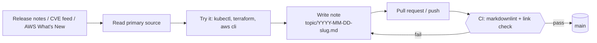

# devops-til — Today I Learned (DevOps · Platform · SRE)

[](https://github.com/arjun001234/devops-til/actions/workflows/lint.yml)


Short, dated notes on things I learn while building and running AWS / Kubernetes platforms:
new Kubernetes and EKS releases, deprecations, CVEs, AWS launches, Terraform changes,
observability and CI/CD practices. Each note is small, practical and links to its primary source.

Maintained by [Arjun Kanojia](https://arjunkanojia.com) — DevOps / Platform Engineer (AWS SA Pro, CKA).

## Contents

- [How it works](#how-it-works)
- [Topics](#topics)
- [Note format](#note-format)
- [Run the checks locally](#run-the-checks-locally)
- [Index](#index)

## How it works



## Topics

| Folder | What goes there |
| --- | --- |
| `kubernetes/` | Upstream Kubernetes releases, API deprecations, scheduling, Karpenter, KEDA |
| `aws/` | EKS versions and add-ons, IAM / IRSA / Pod Identity, networking, Graviton |
| `terraform/` | Terraform / OpenTofu language features, providers, module patterns |
| `observability/` | Prometheus, Grafana, Loki, OpenTelemetry, alerting and SLOs |
| `ci-cd/` | GitLab CI, GitHub Actions, Argo CD, Kargo, multi-arch image builds |
| `security/` | CVEs and patches, Kyverno / OPA policies, image scanning, supply chain |

Folders are created as notes land in them.

## Note format

One Markdown file per note: `<topic>/YYYY-MM-DD-short-slug.md`, based on [`TEMPLATE.md`](TEMPLATE.md).

Every note has: a one-line TL;DR, why it matters for platform teams, a runnable snippet
(command, manifest or HCL), and links to the primary source (release notes, advisory, docs).
No employer-internal details — everything here is reproducible from public sources.

## Run the checks locally

```bash
# Markdown style (same config as CI)
npx markdownlint-cli2 "**/*.md"

# Broken links
docker run --rm -v "$PWD:/data" lycheeverse/lychee --no-progress /data
```

## Index

<!-- Newest first. One line per note: date · topic · title (link). -->

_No notes yet — the first ones land this week._

## License

[MIT](LICENSE)
